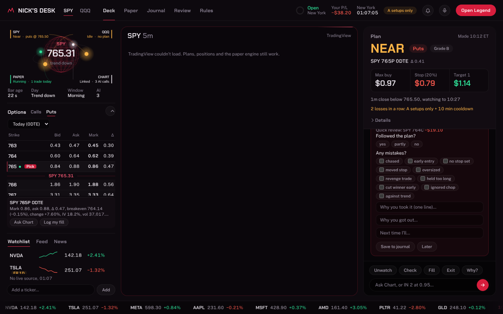
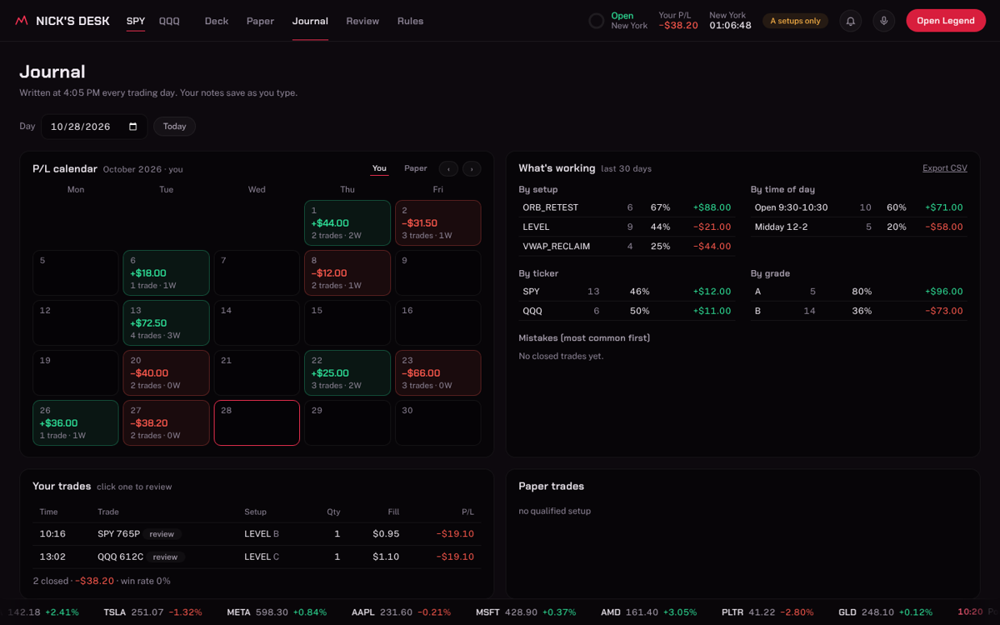
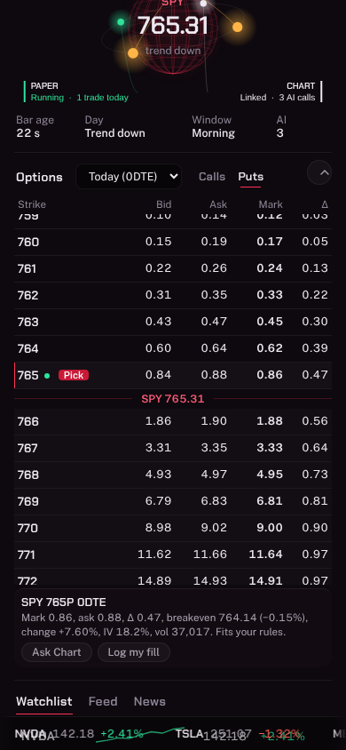
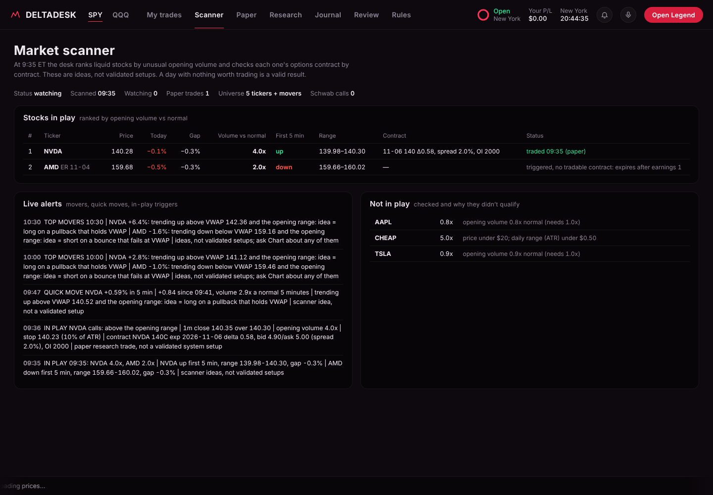
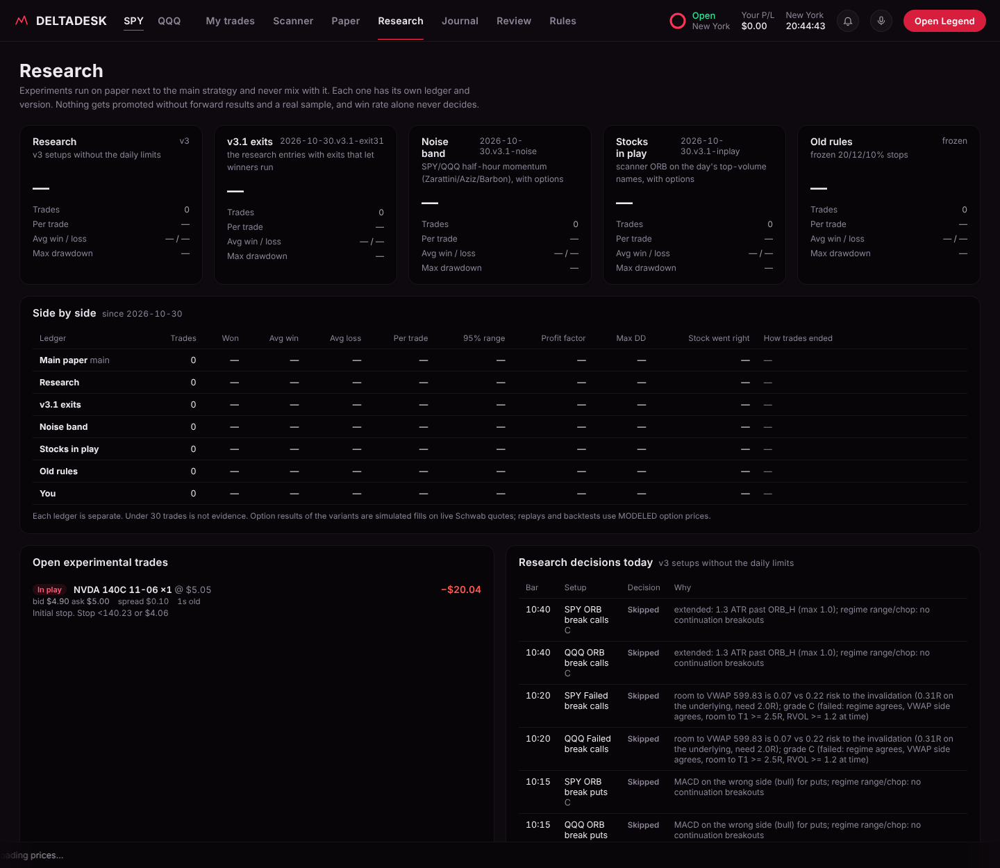

# DeltaDesk

[](https://github.com/nick-devvv/deltadesk/actions/workflows/tests.yml)
  

**A day-trading command deck for 0DTE SPY/QQQ options.** Deterministic code does the math, the monitoring and the paper trading on live Schwab market data. An AI coach ("Chart", a Grok agent) explains the numbers in plain words. Real-money trades are placed by hand. The system never places an order anywhere.


*My trades, on a synthetic test market: the desk's own chart (candles, VWAP, EMAs, 2-minute MACD, levels, stops and fills) and live guidance on a reported trade (TIGHTEN STOP, with the stop, target and profit plan).*

## What it does
- **Plans in code.** Each trade idea gets a full plan: a stop at the chart level that proves it wrong (inside a 20% premium-loss ceiling), T1 at the next opposing level, reward/risk checked at 2:1 on both the stock move and the option dollars after spread, fees and time decay, contract pick (delta 0.45), size and exit rules. The plan is computed before the AI says a word.
- **Setups on finished candles.** Opening range break and retest (a retest must actually touch the level), failed breaks, PDH/PDL retests, VWAP reclaims and a VWAP + MACD strategy (cross arms it, VWAP retest enters, early entry only in a strong trend). All detectors read one snapshot; same-side ideas merge and call/put conflicts skip the bar. Regime from ADX, efficiency, VWAP crossings and overlap; time-matched RVOL; a developing volume profile.
- **Guidance on your own trades, any ticker.** Report a fill and the desk tracks that exact contract live: HOLD, TIGHTEN STOP, TAKE PROFIT or EXIT, with reasons. Each trade is labeled as a validated desk setup or a discretionary idea, and the stop can never pass the trader's 20% max planned loss.
- **Entry gate (anti-chasing).** Every setup is stored once with its trigger, entry zone, latest acceptable entry, invalidation and a level-based target. Reward/risk is recomputed from the current price after costs; past the zone the setup becomes "missed: wait for a new setup or skip it". The gate is code, so no model output or sentiment score can override it.
- **Market scanner.** At 9:35 it ranks ~125 liquid stocks plus the day's movers by unusual opening volume, then checks options contract by contract across expirations: spread, quote age, volume, open interest, delta, time decay and earnings before expiry. A day with nothing worth trading is a valid result.
- **Live alerts.** Desk setups with the full plan, stocks in play, top movers, quick moves on any scanned stock, and changes in the guidance on open trades. Browser pop-ups, sound and phone push (ntfy).
- **Exits as a state machine.** A fixed order: session, premium stop, structure, then momentum fade / 10-minute green stall / T1 rejection, then the T1 partial (a runner only on a clean break), then breakeven, profit lock and trail. Stops only tighten, and every change is versioned. Losing-streak brake, 4 ideas a day, event blocks, all out at 3:25.
- **Paper engine and research ledgers.** Simulated fills on Schwab quotes (buy at the ask, sell at the bid, with costs; no fill without a fresh executable quote). Four ledgers kept apart: the trader, main paper, a research ledger that keeps observing after the limits, and the frozen previous rules for comparison. Research experiments (exits that let winners run, noise-band momentum, stocks-in-play breakouts) each run in their own ledger and version, compared on expectancy, average win vs loss and drawdown. A multi-day backtest with diagnostics (coin-flip baseline, exit breakdown, hold tests, stock move vs option result), a reproducible day replay and a forward-test scorecard fixed before results exist.
- **Journal and learning loop.** After every trade the chat asks a short review (plan followed, mistake tags, why in and out). An end-of-day wrap fills the daily journal. The analytics break results down by setup, time of day, ticker, grade and mistake, with a P/L calendar and CSV export. A 4:20 PM review proposes lessons, which only take effect after the trader approves them.
- **Options chain view.** A Robinhood-style chain with bid, ask, mark, delta and breakeven. The desk's pick is marked, and contracts that fit the rules get a green dot. Read-only.
- **Forecast research.** Runs the Kronos time-series model in shadow mode only, scored against no-change and momentum baselines, with every forecast tagged by its data source.

| Journal | Phone |
|---|---|
|  |  |

## Architecture
```
Browser (single-page deck, Lightweight Charts fed by the server)
   |  polls /api/state every 2 s and /api/chart every 5 s
server.py  (Python HTTP API, token-protected, exposed via Tailscale Funnel)
   |-- marketdata.py    one data pipeline: Schwab stream or REST, freshness labels, gaps, fallback marked not executable
   |   |-- schwab.py / schwab_stream.py   market data only; trading and account endpoints refused in code
   |-- indicators.py    VWAP, MACD, Wilder ATR/ADX (TA-Lib parity), time-matched RVOL, chop measures, volume profile
   |-- strategy.py      levels with sources, regime, setups, conflict skip / merge, qualification, grade
   |-- optionmath.py    structure stop, 20% ceiling, T1, 2:1 in both units, sizing
   |-- paper.py / exits.py   simulated fills and the exit state machine
   |-- engine.py        snapshots per finished bar, ledgers, alerts, candidates journal
   |-- commands.py      chat text -> actions in code; AI only for judgment
   |-- scanner.py       stocks in play: baselines, 9:35 ranking, option liquidity scoring, live movers, research ledger
   |-- noiseband.py     noise-band momentum research ledger (SPY/QQQ)
   |-- backtest.py / diagnostics.py   multi-day sandboxed backtest and cause-finding diagnostics
   |-- replay.py / evaluation.py   day replay (sandboxed) and the forward-test scorecard
   `-- kronos_shadow.py separate forecast process (shadow only)
Chart (Grok agent) <- webhook with compact context (rules, plan, levels, regime, 3 knowledge cards)
```

## Design choices
- **Code computes, AI explains.** Standard commands never call the model, which keeps AI cost to about 20 scheduled runs a day plus questions. The model may not change any number.
- **Safety by construction.** No code path sends an order. Paper trading is simulated internally, and the Schwab client allows only market-data paths (plus the one preferences call that returns the streaming address).
- **Honest numbers.** Indicators run on finished bars only, option P&L in replays is labeled modeled, and results from different ledgers or data sources are never mixed.
- **Tested.** 140 offline tests (no network, no AI, a fake Schwab provider) cover indicator parity, levels, conflict handling, atomic idea reservation under threads, option math units, every exit rule and their order, outages, stream message merging, the replay sandbox and safety refusals.

## Stack
Python 3.12, SQLite, pandas/numpy, websockets; vanilla HTML/CSS/JS with TradingView Lightweight Charts 5.2.1 (Apache-2.0) and canvas animations; Schwab market-data REST and streaming APIs; Grok agent routines; pytest.

## Versions
- **v3 (Oct 29, 2026)** rebuilt the data pipeline, the setup rules and the exits after a one-day audit. See `docs/V3_REPORT.md`.
- **v3.1 (Oct 30, 2026)** added the scanner, trade guidance for any ticker, live market alerts, three research experiments and the diagnostics. See `docs/V31_REPORT.md` and the research behind it in `docs/RESEARCH_NOTES.md`.
- **v3.2 (Oct 30, 2026)** added a Schwab connection the trader manages from the page, live charts for any ticker, a setups board with written rules, an anti-chasing entry gate in code, source-labeled catalysts (SEC EDGAR, optional xAI X search), earnings in three phases and scheduled paper strategies. See `docs/V32_REPORT.md`.
- **v3.3 (Oct 30, 2026)** fixed eight defects found in an outside audit, each as a new version next to the old one:
  - an entry gate that checks both sides of the zone and fails closed;
  - an independent gated ledger;
  - no look-ahead in 2m features;
  - one theta unit;
  - a causal stocks backtest;
  - paper fills checked against the limit after slippage;
  - a content-keyed indicator cache;
  - session-clustered statistics.

  It also added a strategy register with spec hashes, a router that logs every setup, walk-forward folds, matched random-entry controls with Holm adjustment, and a signal study. No strategy has beaten its random control yet, so every desk setup is labeled research only. See `docs/V33_REPORT.md`.

| Scanner | Research |
|---|---|
|  |  |

## Running it
`python3 server.py` with `DESK_TOKEN`, `SCHWAB_APP_KEY`/`SCHWAB_APP_SECRET` (market data, see `docs/SCHWAB_SETUP.md`), and optionally `CHAT_WEBHOOK`, `NTFY_TOPIC`, `KRONOS=1` set in the environment. Never commit keys. Tests: `pip install -r requirements.txt && python3 -m pytest -q tests/` (they also run on every push via GitHub Actions).

## Disclaimer
This is a personal project, shared for portfolio purposes. It is not financial advice and not a trading service. It never places orders: paper trading is simulated inside the app, and every real trade is placed by hand. Options trading carries a high risk of loss.

Built with help from Claude (Anthropic). Credits for ideas and tools are in `docs/CREDITS.md`. Copyright © 2026 nick-devvv. All rights reserved.
