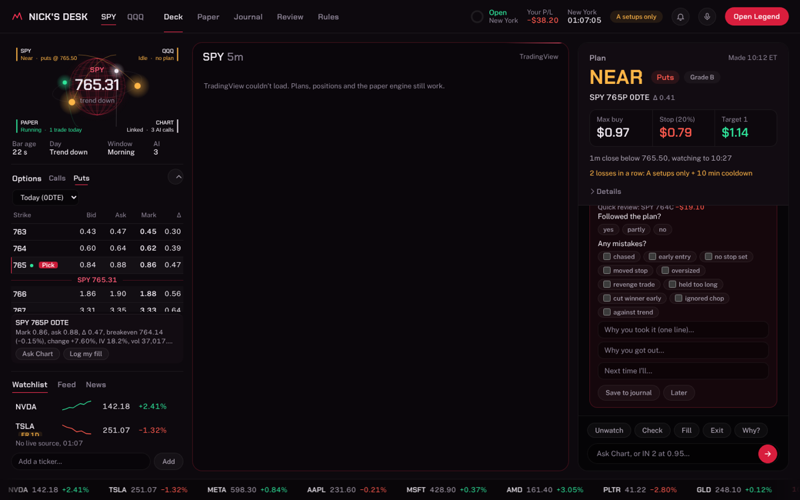

<div align="center">

# DeltaDesk

**A quant paper-trading desk for stocks, ETFs and options.** Code computes every number, strategies reach the desk only after a pre-registered backtest, and every real trade is placed by hand.

[](https://github.com/nick-devvv/deltadesk/actions/workflows/tests.yml)


</div>


<sub>The desk's chart and trade plan, on a synthetic test market.</sub>

## What it does

- **Paper-trades tested strategies** on live Schwab quotes, each in its own ledger and risk book.
- **Co-pilot alerts for SPY and QQQ:** pattern alerts with an indicator readout, each labeled with how it did in testing, sent to Telegram (with Took / Skipped buttons) and phone push.
- **Plans in code:** entry, stop, target and size are computed before anything is explained. Chart, an AI agent, explains the numbers in chat but can never change them.
- **No real-money orders:** paper trading is simulated or on Alpaca's paper account, Schwab trading endpoints are refused in code, and `touch KILL` flattens and halts the desk.

## On paper now

| Ledger | What it does | Held |
|---|---|---|
| `core_sso` | SSO while SPY is above its 200-day trend, T-bills (SGOV) when it isn't | Weeks to months |
| `core_spy` | SPY as the core position | Long term |
| `etf10_rsi2` | Buys short pullbacks (RSI 2) on 10 ETFs | Days |
| `pead_t21` | Post-earnings drift | 20 sessions |
| `nbs_spy_ls`, `nbs_spy_long` | Noise-band momentum on SPY shares | Same day |
| `noise` | The reference noise-band strategy on 0DTE SPY and QQQ options | Same day |

A few research-only ledgers run beside them for comparison. None is promoted yet: each needs 40 forward paper trades that match its backtest. Full rules and results: [`docs/STRATEGY_PLAN.md`](docs/STRATEGY_PLAN.md).

## How a strategy gets on the desk

1. **Written rules first:** taken from a published paper or a large backtest, frozen before any result.
2. **Two tests:** a research window (1997–2021), then a sealed 2022–2025 window, run once.
3. **Judged on profit after costs,** against matched random entries, with every variant tried counted.
4. **Paper forward test,** then promotion only if live fills match the backtest.

## Run it

```bash
pip install -r requirements.txt
python3 -m pytest -q tests/   # offline: no network, no keys
python3 server.py             # http://localhost:8765
```

Live data needs `DESK_TOKEN` and Schwab market-data keys ([`docs/SCHWAB_SETUP.md`](docs/SCHWAB_SETUP.md)). The desk runs on its own small server, and every push to `main` runs the tests on GitHub first.

**Built with:** Python, SQLite, Schwab and Alpaca market data, WRDS (research), TradingView Lightweight Charts, Telegram and ntfy.

---

<sub>A personal project, not financial advice. It never places a real order, and options carry a high risk of loss. Built with help from Claude (Anthropic); credits in [`docs/CREDITS.md`](docs/CREDITS.md). © 2026 nick-devvv. All rights reserved.</sub>
